How-to notes for [Audio Lab]({{ '/projects/audio-lab/' | relative_url }}) — a USB ADC, a reference tape or test record.

  <a class="btn btn--primary" href="https://github.com/stuart11n/s16n-releases/releases/download/audio-lab-latest/s16n-audio-lab.exe">Download for Windows</a>
  <a class="btn btn--ghost" href="https://github.com/stuart11n/s16n-releases/releases/download/audio-lab-latest/s16n-audio-lab-ubuntu">Linux</a>
  <a class="btn btn--ghost" href="https://github.com/stuart11n/s16n-releases/releases/download/audio-lab-latest/s16n-audio-lab-macos-arm">macOS ARM</a>
  <a class="btn btn--ghost" href="{{ '/projects/audio-lab/' | relative_url }}">Back to Audio Lab</a>

### Contents
{:.no_toc}

* TOC
{:toc}

### Recommended ADC

Audio Lab reads a stereo USB (or other system) audio device on the desktop. You need a class-compliant ADC with **line** inputs — not the laptop or phone microphone.

- **Behringer U-Phoria UMC202HD** — combo inputs with a LINE pad; set them to line, not instrument or mic.
- **Behringer UCA202 / UCA222** — cheap RCA line-in, no mic preamp in the way. Fine for a tape deck or a phono stage. Some units need **−1 sample** on **Channel B trim** on the **Source** tab. It can appear and disappear. Confirm with one output from a source into both ADC inputs — **X-Y** should be a perfect line.
- Any other 2-in USB interface with a LINE pad (**Focusrite Scarlett 2i2** and similar) works if you set the inputs to line.
- 48 kHz is enough. Max frequency tracks the open device’s Nyquist.
- A turntable still needs a phono stage in front of the ADC. Do not plug the cartridge into line-in.

### Set input level

On **Source**, pick **Max Input Level** for your device (**2 dBV** typical, **1.8 dBV** Pro-class, **+17.8 dBV** UMC202HD). That only scales the volt labels — set LINE gain on the interface (or in the Windows mixer) so the signal is healthy without clipping.

Performing a **2 dBV** calibration is recommended but not mandatory for many measurements and adjustments — see [Calibration](#calibration).

### Controls

Side tabs on the right: **Control · Measure · Source · Tools**. Knobs and channel buttons sit in the mid column. Mode buttons and the rest of the Control panel sit on the right. What you get depends on **Y-T**, **X-Y**, **W&amp;F**, **FFT**, or **Spectrograph**.

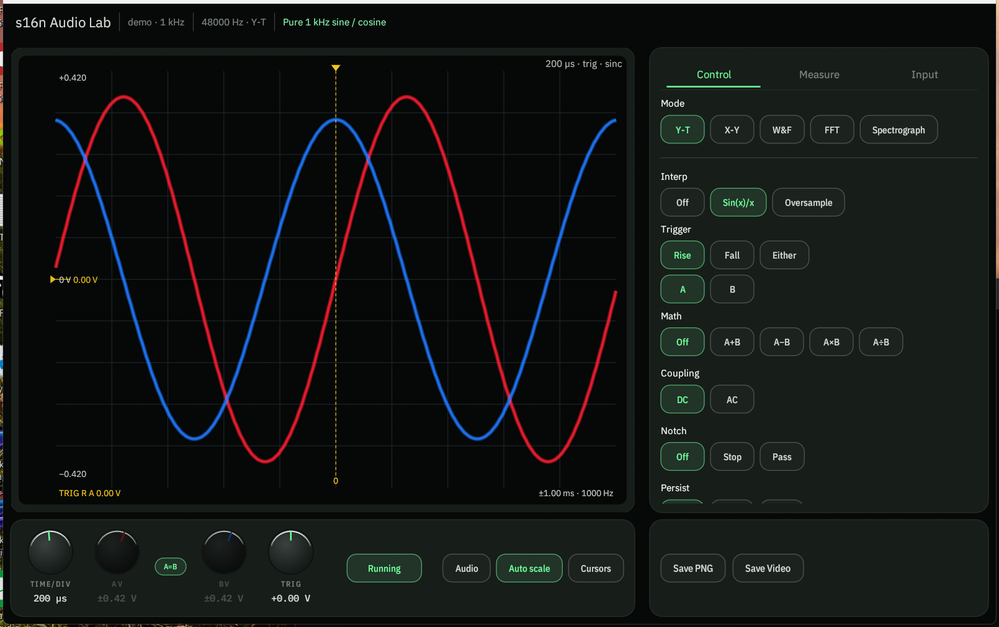{: .center-image }

#### Channels

Click **A** or **B** to show or hide that trace. At least one channel stays on. The swatch next to the letter is the channel color — click it to pick a new one.

**X-Y** forces both on and relabels them **X = A** and **Y = B**. **W&amp;F** reads A only (**In = A**). **Spectrograph** uses the **Channel** row (**Mix** / **A** / **B** / **A−B**) instead of hiding traces.

#### Auto scale, Measure, Audio, Cursors

- **Auto scale** fits the plot to the signal. The Y (or dB range) knob greys out while it is on. Turn Auto off to set the scale yourself — needed when you want A and B on the same volts/div.
- **Measure** opens the readout: Vpp, RMS, frequency, period, duty, and more. **THD** is included. Tabs pick A or B (and the math channel when that is on).
- **Audio** plays the analysed signal through the speakers. It starts off.
- **Cursors** — Y-T drops two vertical time cursors; FFT / Spectrograph drop frequency cursors. Drag A and B on the plot. Deltas land in the Measure list.

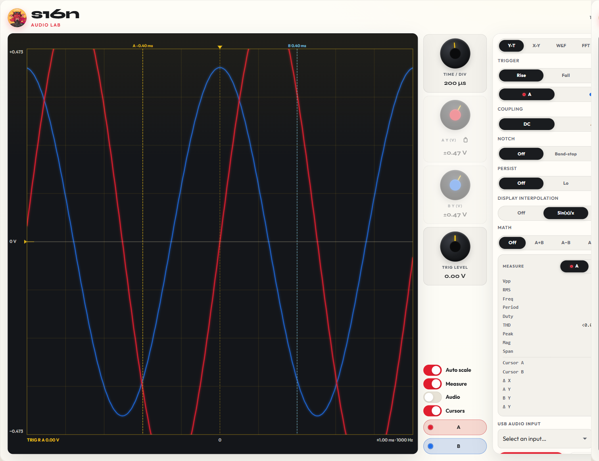{: .center-image }

**X-Y** swaps Cursors for **Phase Aid** — a chord that tints green in phase and red when the figure is ≥20° out.

#### Knobs

**Y-T** has four knobs:

- **Time / div** — shared timebase for A and B.
- **A Y (V)** — volts per division for A. The padlock locks B’s Y to A.
- **B Y (V)** — independent B scale when the lock is open.
- **Trig level** — trigger threshold. Edge is Rise / Fall / Either; source is A or B.

Click the padlock (**Unlock B from A**) so B’s Y no longer tracks A. Lock it again to copy A onto B. A math channel other than Off forces A and B back together.

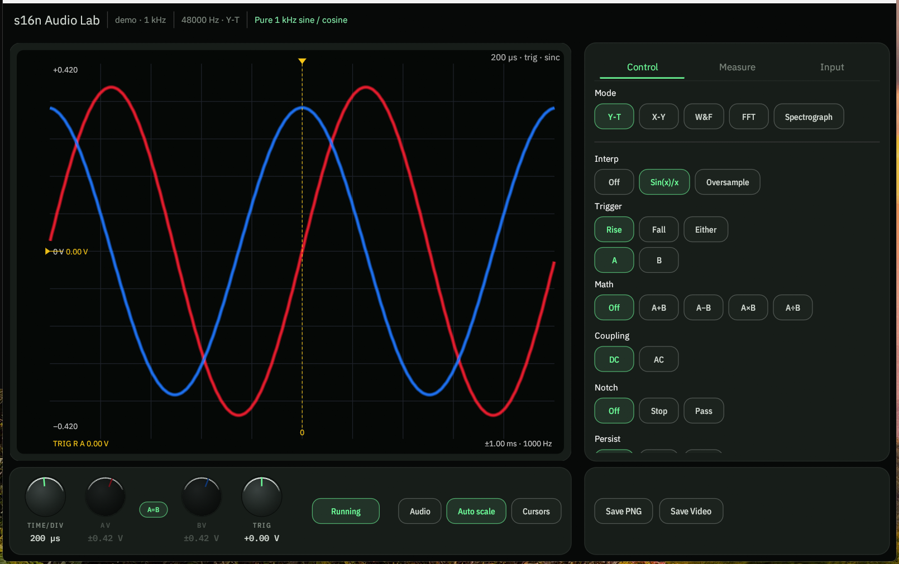{: .center-image }

**X-Y** has one **Time / div** and one **Y (V)**. No A/B Y lock — A is always X and B is always Y.

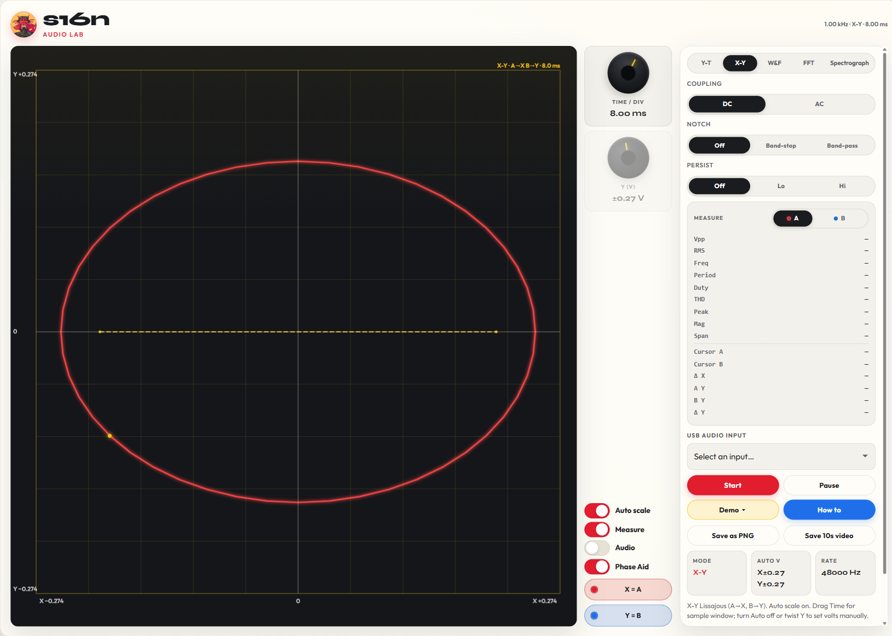{: .center-image }

**FFT** and **Spectrograph** replace time/Y with **Max freq** (up to Nyquist) and, in dB / Pink EQ, **dB range** (40–120 dB). In FFT Linear, that second knob is a magnitude scale. Auto scale still owns the Y knob until you turn it off. Spectrograph has no Persist control — it has **Y axis**, **Channel**, and **Sharp** instead.

**W&amp;F** hides the knobs. Use **Standard**, **Carrier**, **Eccentricity**, and **Range % FS** on the panel instead.

#### Coupling

**DC** keeps any offset. **AC** strips DC so a small AC signal is not sitting on a rail. Coupling is on every mode except W&amp;F (the meter wants the raw carrier).

#### Notch

The panel is labeled **Notch**. Modes: **Off**, **Band-stop**, and **Band-pass**.

- **Band-stop** cuts a narrow band — 50 / 60 / 120 Hz presets for mains, or drag **Freq**.
- **Band-pass** keeps a band and rejects the rest.
- **Width** is Q. Higher Q is a tighter notch.

Notch is not on W&amp;F.

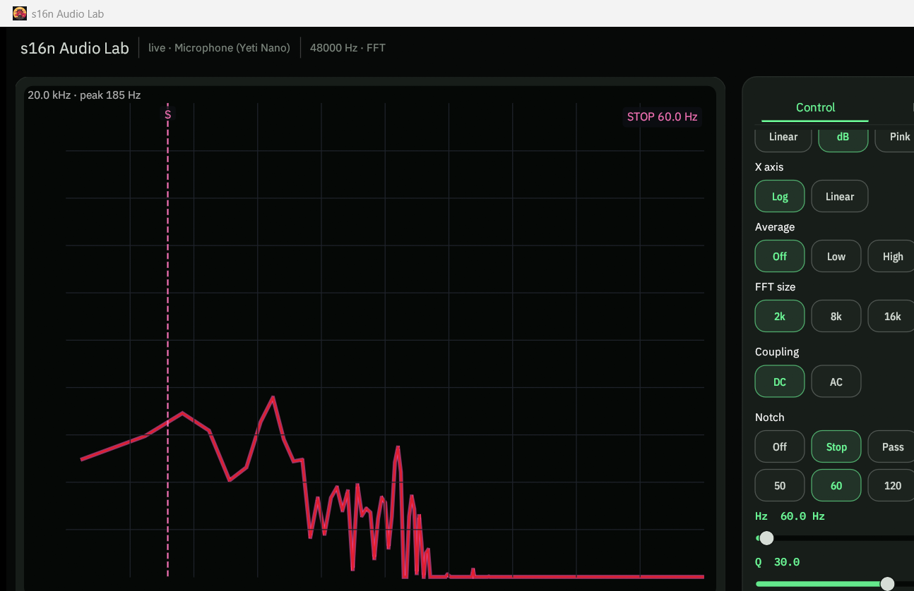{: .center-image }

#### Persist

**Off** / **Lo** / **Hi**. Hi is the phosphor trail — useful for a drifting Lissajous or a rare glitch. The **CD RF eye** demo is the clear case: without persist the diamond lattice is hard to see; **Persist** Hi burns the eye in as traces overlay. Persist is on Y-T, X-Y, and FFT. Spectrograph and W&amp;F do not have it.

#### Magnitude, X axis, Average

FFT-only, above Coupling:

- **Magnitude** — **Linear**, **dB**, or **Pink EQ** (+3 dB/oct so ideal pink reads flat).
- **X axis** — **Log** (20 Hz–max) or **Linear** (0–max).
- **Average** — **Off** (instant), **Low**, or **High** (steady pink curve).

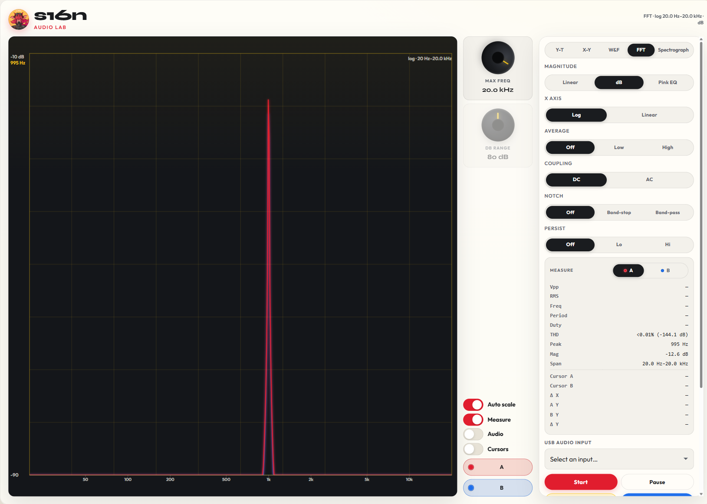{: .center-image }

Y-T also has **Display interpolation** (Off, **Sin(x)/x**, Oversample) and **Math** (A+B, A−B, A×B, A÷B). Those sit under Persist.

#### Spectrograph

Spectrograph-only, above Coupling. Time still scrolls right→left; these pick what the waterfall shows.

- **Y axis** — **Lin** (0–max), **Log** (20 Hz–max), **Mel** (denser lows), or **Bark** (critical bands). Frequency is on Y, not X.
- **Channel** — **Mix** (mean of A and B), **A**, **B**, or **A−B** / Diff (diverging colours so a difference stands out).
- **Sharp** — **Off** is ordinary magnitude columns. **On** is frequency reassignment — thinner ridges, less smear.
- **Scrub** — a **10×** overview sits under the plot (~45 s of history). Drag it to move the 4.5 s window. Scrubbing pauses the live scroll; **Resume** (or P) jumps back to now.

Cursors here are horizontal (frequency). The **Hello** demo is this view.

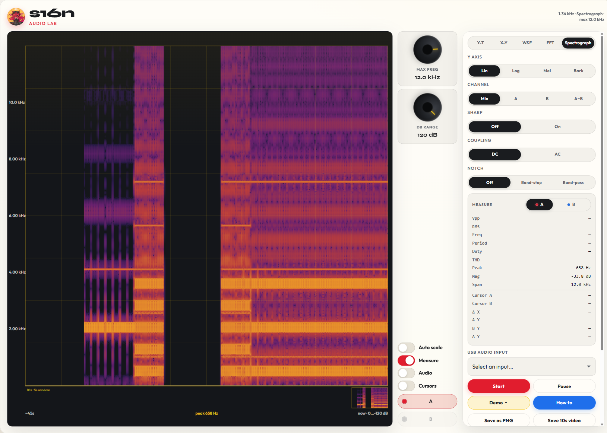{: .center-image }

### Align tape-head azimuth

Use a dual-channel azimuth tone on a reference tape — typically 8, 10, or 15 kHz, recorded on both tracks. Turn on **Phase Aid** — that chord is the setting this check is built around. An FFT / Spectrograph confirm helps too.

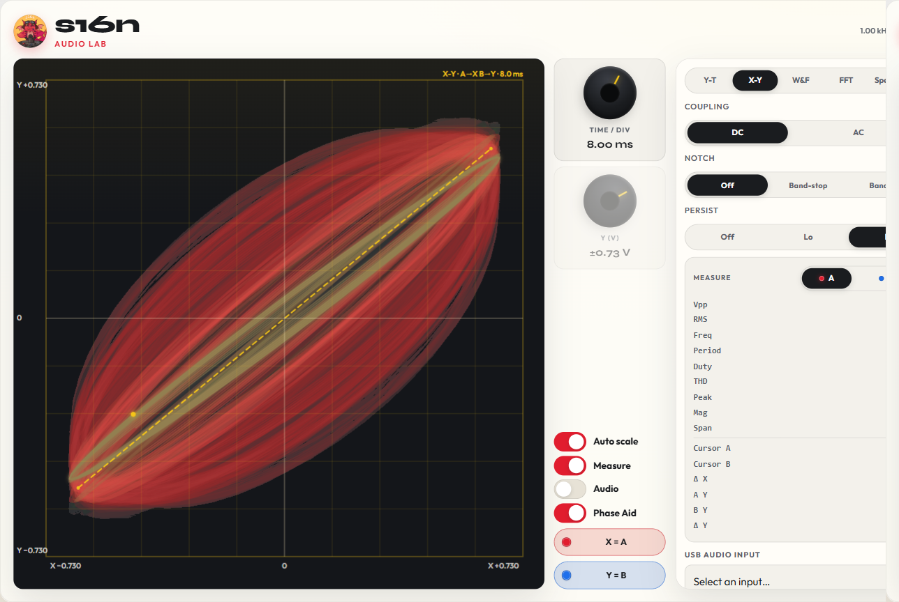{: .center-image }

1. Take the deck’s line outputs into a USB ADC. In Audio Lab, pick that device and Start. Show **A** and **B**.
2. Play the azimuth section. Switch to **X-Y**. A is X, B is Y. Auto scale on. Enable **Phase Aid**.
3. Turn the azimuth screw slowly. Aim for a tight, stable line (or a very thin ellipse) with the Phase Aid chord along it. A fat, rotating, or open figure means the head is still off.
4. Switch to **FFT** as a check. Both channels should sit on the same peak; wandering or a washed-out comb means phase is still drifting. **Spectrograph** shows the same thing over time — the two traces should hold still.

Do this after the tape path is clean and the tape is seated. Recheck at a second frequency on the tape if it has one. The **Tape wobble** demo is this view without a deck.

### Check tape wow &amp; flutter

Use the W&amp;F section of a reference tape: **3.15 kHz** for DIN / CCIR, or **3 kHz** for JIS / NAB. Standards: DIN, JIS, NAB, CCIR, AES 2σ, and unweighted — use the one printed on the tape.

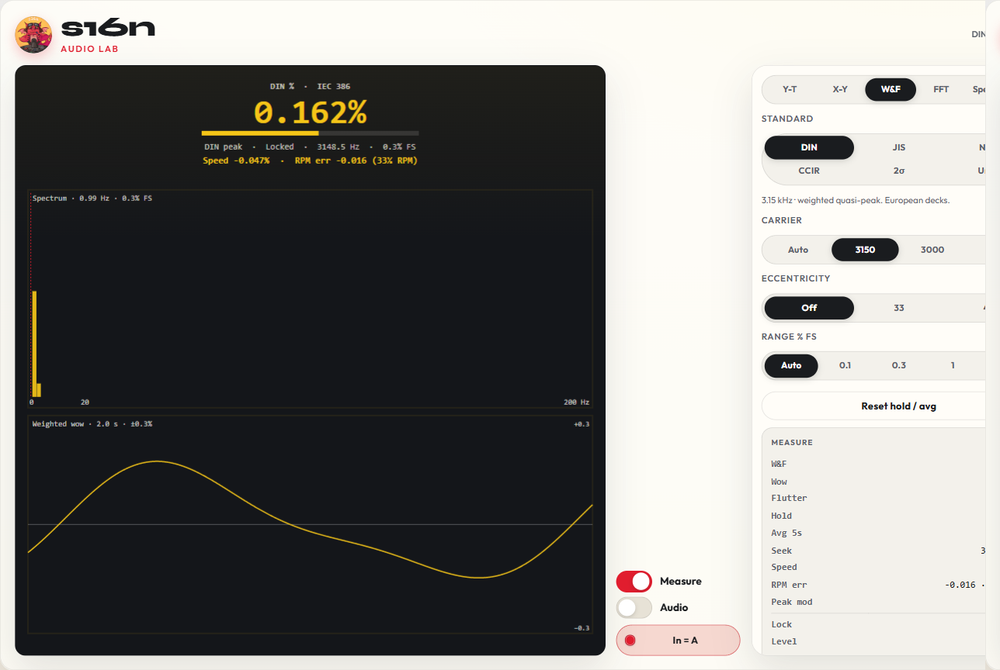{: .center-image }

1. Line out from the deck into the USB ADC. Start Audio Lab and switch to **W&amp;F**. The meter reads channel A only — hide B if it is noisy.
2. Play the tone. Set **Standard** to DIN (or the standard that matches the tape). Set **Carrier** to 3150 (DIN / CCIR) or 3000 (JIS / NAB). Leave **Eccentricity** Off — that notch is for turntables.
3. Wait until Seek locks and the W&amp;F, wow, and flutter readouts settle. Use hold / 5 s average if the number is bouncing.
4. Compare the reading to the deck’s spec. A high wow (low-rate) number usually means capstan or belt; high flutter is more scrape, roller, or motor cogging.

Level should be healthy on the meter. If Lock never appears, the tone is too quiet or the wrong frequency.

### Check turntable wow &amp; flutter

Use a test record with a **3.15 kHz** (DIN / CCIR) or **3 kHz** (JIS / NAB) tone. Some discs also have 1 kHz. Set **Eccentricity** to 33 or 45 so once-per-rev wow from an off-center hole is notched out.

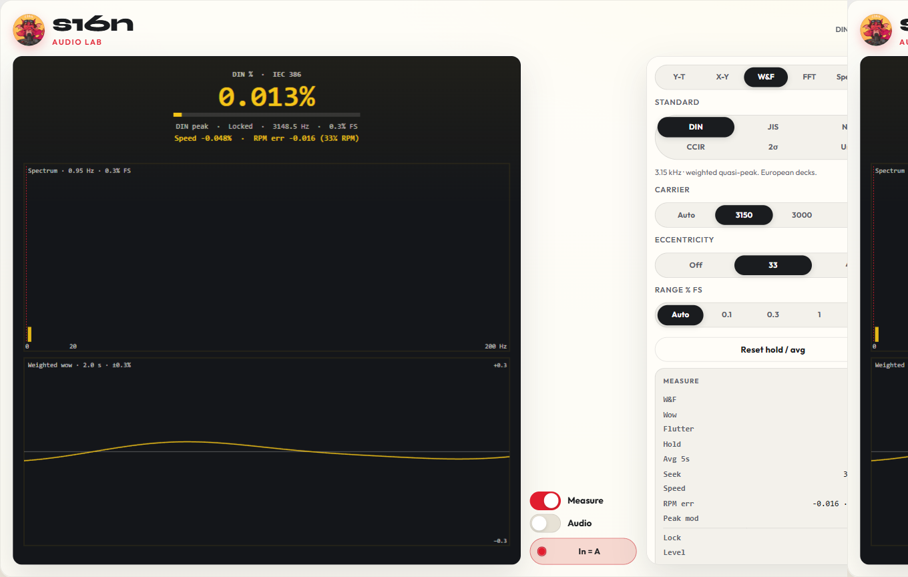{: .center-image }

1. Phono stage into the USB ADC. Start Audio Lab and switch to **W&amp;F**. The meter reads channel A only.
2. Play the tone at 33 or 45 as marked on the disc. Set **Standard** to DIN (or the standard that matches the record). Set **Carrier** to 3150, 3000, or 1000 Hz.
3. Set **Eccentricity** to 33 or 45. Leave it Off if you want that eccentricity in the number.
4. Wait for Seek to lock. Speed % and RPM error show under the main readout when the carrier is held. Use hold / 5 s average if the value is moving.
5. Compare W&amp;F, wow, and flutter to the table’s spec. High wow is usually platter, belt, or a warped disc; high flutter is more motor cogging or a dirty bearing.

The **Turntable wow** demo is a 3150 Hz tone with 0.55 Hz wow — Eccentricity 33 is the recommended setting on that.

### Check turntable frequency response

Use a test record with a **pink-noise** band, through a phono stage, into the USB ADC. Set **Pink** magnitude EQ. For a vinyl cut, use **Log** X and **Average** High so bass and treble share the plot and the curve settles.

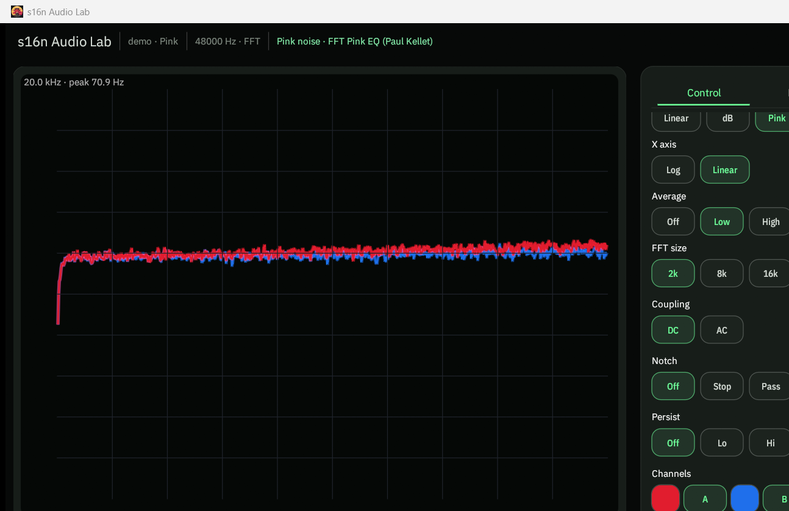{: .center-image }

1. Start Audio Lab on that input. Switch to **FFT**. Show **A** and **B**.
2. Set Magnitude to **Pink EQ** (+3 dB/oct). Ideal pink then reads flat. For a record, set X to **Log** and **Average** to High and wait for the curve to settle.
3. Play the pink-noise band at a typical tracking force. Auto scale on, or fix **dB range** so both channels share a scale.
4. A flat-ish pair of traces is the cartridge + arm + preamp response after RIAA. Look for channel mismatch, a rising or falling treble tilt, a bass hump (arm/cartridge resonance), or a suck-out. Switch Magnitude to **dB** if you want the raw −3 dB/oct pink slope instead.

The **Pink noise** demo starts the same FFT + Pink EQ path without a record (Linear X, Average Low). Switch to Log / High when you want the vinyl-style view.

### Set turntable anti-skate

Use a test record with a **tracking / anti-skate** band (a loud 300 Hz tone is common) or a silent, unmodulated groove. Tracking force should already be set. **THD** is the readout to watch — it should stay matched on A and B. An FFT confirm helps too.

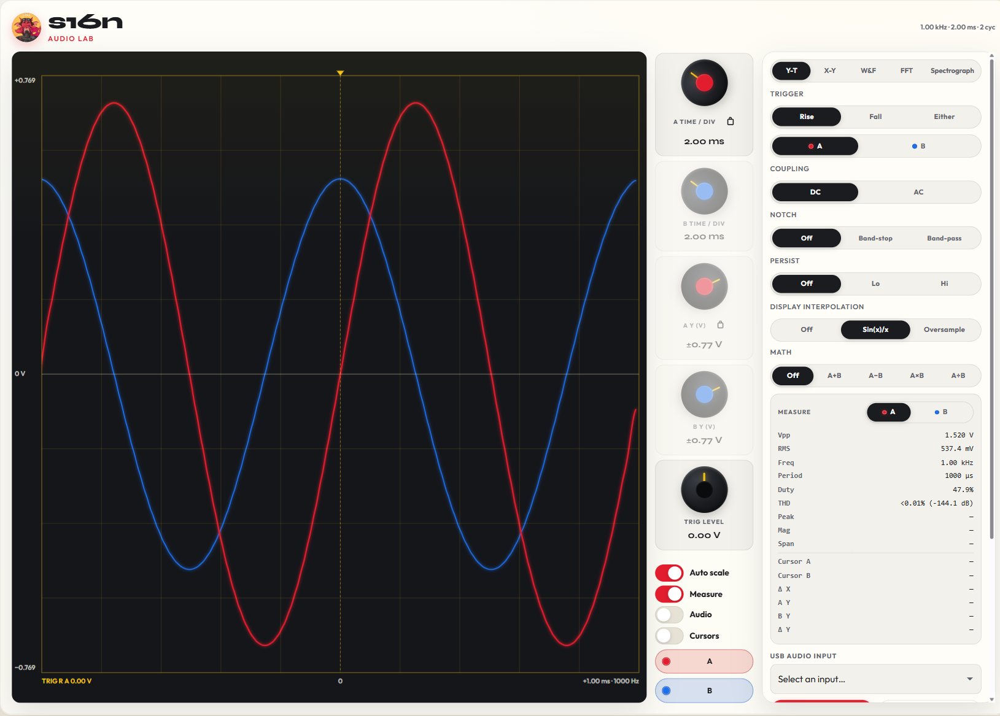{: .center-image }

1. Phono stage into the USB ADC. Start Audio Lab. Show **A** and **B** (A is left, B is right if the ADC is wired that way).
2. Play the tracking band. Switch to **Y-T**. Auto scale on. Measure on. A clean tone is a steady pair of sine waves. Mistracking is a sudden spike, a collapsing edge, or hash on one channel — and **THD** jumping on that side only.
3. Switch to **FFT** as a check (dB, **Log** X, Average Off). Both channels should share one peak and the same harmonic stack. Extra broadband junk or one channel’s harmonics jumping means that side is losing the groove.

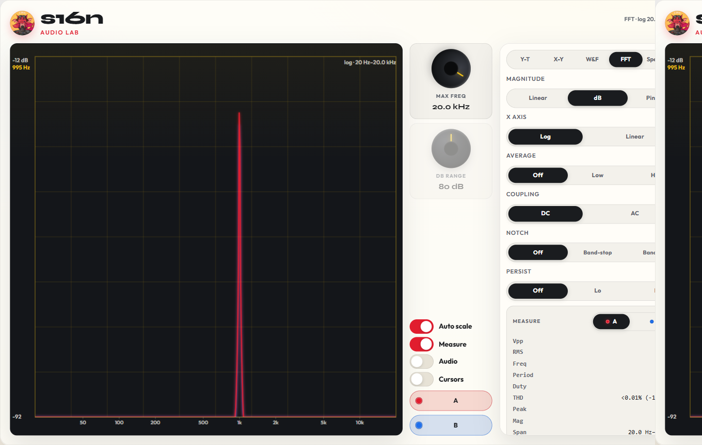{: .center-image }

4. Turn anti-skate until A and B break up together — or neither does at that level. Too little anti-skate usually dirties **B** (outer / right wall) first; too much dirties **A** (inner / left). If the disc has an inner-groove band, recheck there — skating force is highest toward the label.

A silent groove is a cruder check: the arm should sit still, and Y-T / FFT noise should look similar on A and B. Do not chase a steady midband level offset with anti-skate — that is channel balance.

### Check cassette channel balance

Use the **400 Hz** or **1 kHz** reference on a cassette test tape, or a tone recorded equally on both tracks. Midband, so azimuth is not the whole story. **Y-T** with Auto off and the **RMS** / **Vpp** readouts, or an FFT peak compare.

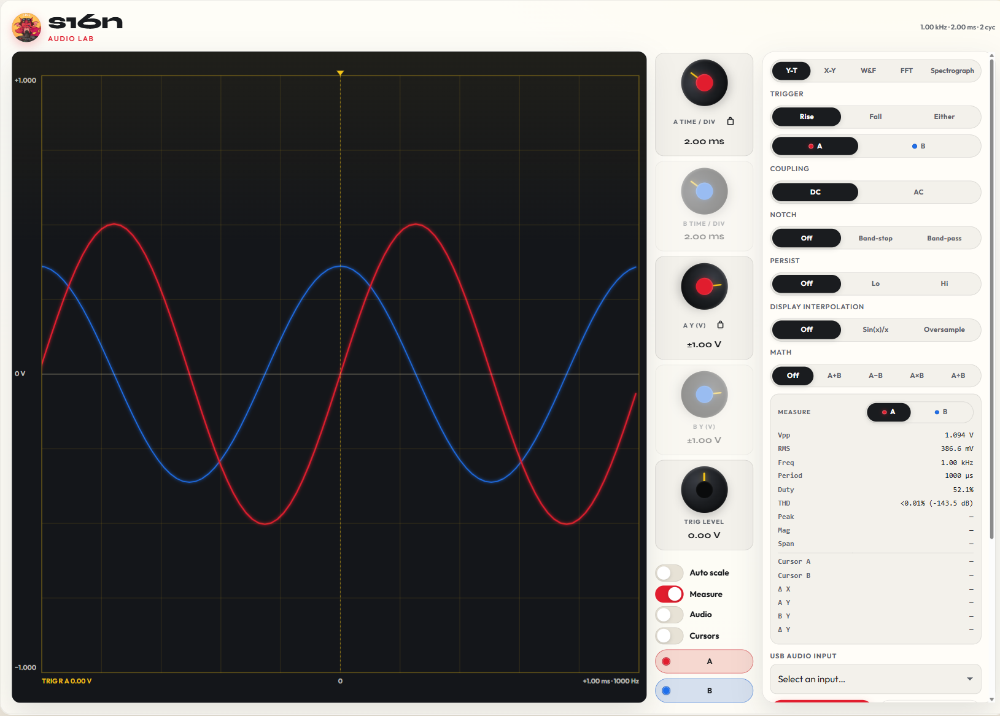{: .center-image }

1. Deck line out into the USB ADC. Start Audio Lab. Show **A** and **B**.
2. Play the tone. **Y-T** with Auto off so both traces share a scale, or read **RMS** / **Vpp** on each channel. Switch to **FFT** and compare the two peaks in dB.
3. A few tenths of a dB is normal. Around 1 dB or more is worth chasing: playback balance, record-level pots, or head height. If the midband matches but the highs do not, go back to azimuth.

A commercially recorded cassette can sanity-check a deck, but the tape itself may already be unbalanced.

### Check turntable channel balance

Use a **1 kHz** (or other midband) band on a test record, through a phono stage, into the USB ADC. Prefer a lateral / L+R tone so both walls are driven the same. Same **Y-T** setup as the cassette check — Auto off, read **RMS** / **Vpp**. FFT works too.

1. Start Audio Lab on that input. Show **A** and **B**.
2. Play the tone at a typical tracking force. **Y-T** with Auto off, or read **RMS** / **Vpp**. **FFT** with both traces — the peaks should sit on top of each other.
3. A few tenths of a dB is typical cartridge scatter. A steady 1 dB or more is cartridge, wiring, or the phono stage — not anti-skate. If only the highs disagree, check stylus azimuth and the frequency-response how-to above.

Pink-noise FFT (Pink EQ, **Log** X, Average High) shows the same imbalance across the band if you do not have a 1 kHz cut.

### Input sample trim

Some USB ADCs deliver B one sample late or early versus A. That looks like a fat X-Y ellipse on a mono tone, or A and B not stacking on Y-T, even when the source is identical.

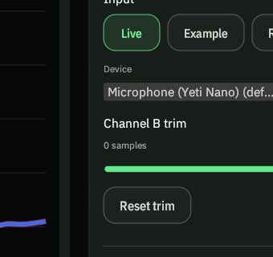{: .center-image }

1. Open the **Source** tab. Pick the USB device (**Live**).
2. **Channel B trim** is −10…+10 samples. **0** is no shift. Positive delays B; negative advances B. **Reset trim** returns to 0.
3. Connect **one** output from a source to **both** ADC inputs (Y-split or two leads from the same jack). Switch to **X-Y**. A perfect match is a tight 45° line. An open ellipse means the channels are skewed — adjust trim until the figure collapses to a line.

The UCA202 / UCA222 often wants **−1**. Do not assume that. Other interfaces are usually 0. The only 100% check is that one-output-into-both-inputs **X-Y** line.

### Tools

The **Tools** tab is a tone generator on the **default playback** device — useful for a known stimulus into a loopback, a tape deck record path, or another ADC under test. It does not change live input gain.

- **Max Output Level** — dBV of a 0 dBFS sine on that output, saved per device (**2 dBV** typical, **1.8 dBV** Pro, **0.8 dBV** UMC202HD). Those presets assume the interface **output gain is at max**.
- **Level** — digital tone level relative to that full scale: **0 dB**, **−10 dB**, or **−20 dB**, with Vrms / dBV / peak dBFS under the chips.
- **Frequency** — **Off**, **3 kHz**, **3150 Hz**, **10 kHz**, **1 kHz**, **Sweep** (20 Hz ↔ 20 kHz log, 10 s each way), **Pink** (forces Level to −20 dB), or **Custom** (drag Hz).
- **Start** / **Stop** — open or close the tone stream on the default output.

Prefer **−10 dB** or **−20 dB** into gear that clips near line level; leave **0 dB** for a full-scale check or the [Calibration](#calibration) steps below.

### Calibration

Performing a **2 dBV** calibration is recommended but not mandatory for many measurements and adjustments. It makes the volt / dBV readouts match a known line level when you are setting gains or calibrating meters.

#### Calibrate output to 2 dBV

**Max Output Level** is a label for “what dBV is a 0 dBFS sine on this output?” It does not change the DAC voltage by itself — an RMS voltmeter on the line out does the real check.

1. Set the interface **output gain to max** (or to the fixed line-out you will always use).
2. On **Tools**, set **Max Output Level** to **2 dBV**, **Level** to **0 dB**, and **Frequency** to **1 kHz**. **Start**.
3. Measure the analog output with a true-RMS voltmeter. **+2 dBV** is **1.259 Vrms** (≈ **1.26 V**).
4. If the meter already reads ~1.26 Vrms, the cal matches — leave **Max Output Level** on **2 dBV**. If it is off, trim the interface output gain until the meter hits ~1.26 Vrms, then keep **Max Output Level** at **2 dBV** so the app’s dBV / Vrms readouts agree with the bench.

After that, drop **Level** to **−10 dB** or **−20 dB** for everyday stimulus so you are not driving gear at full scale.

#### Calibrate input to 2 dBV

Same idea on the capture path: **Max Input Level** is “what dBV is 0 dBFS on this ADC?” — it scales the Y-T / Measure volt labels. It does not change Windows or hardware gain by itself.

1. Finish the **2 dBV** output cal above (tone at **Level** **0 dB**, **1 kHz**, ~1.26 Vrms on the meter).
2. On **Source**, set **Max Input Level** to **2 dBV**. Pick **Live** and the USB ADC.
3. Loop the tone output straight into that ADC’s line inputs (same channels you will measure with).
4. Switch to **Y-T**, open **Measure**, read **RMS**. In the **Windows sound mixer**, open the recording device for that ADC and adjust its **input** level until **RMS** shows about **1.26 V** (and the sine is not flat-topped). At **Max Input Level** **2 dBV**, that readout means the loopback is sitting at digital full scale — input cal matches the output cal.

Keep the LINE pad on; do not use mic gain for this. If you cannot reach 1.26 Vrms without clipping, the interface’s max input is below +2 dBV at that pad — pick a different **Max Input Level** preset to match a measured full-scale, or pad the loopback.
