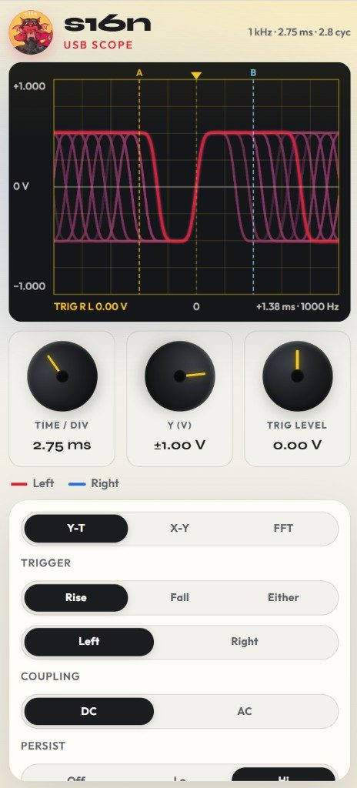

{: .center-image }

A browser oscilloscope, spectrum analyzer, spectrograph, and wow &amp; flutter meter for USB audio inputs — audio frequency only (not RF or lab-bandwidth scopes). Plug in a USB ADC, pick the device, and Start — or use built-in demos. Useful for checking line-level signals from turntables and tape decks for setting head azimuth, anti-skating, measuring W&amp;F, frequency response, testing other audio equipment, codecs, and test gear.

Core scope features are free. **Pro** ($15.99 via PayPal) unlocks unlimited FFT and Spectrograph (free preview is 60 s each), log X axis, FFT zoom, band-stop / band-pass, cursors, Save PNG, Save Video, interpolation, THD, trigger level, Y-T math, independent A/B time/div and Y, Phase Aid, and extra W&amp;F standards. After payment, enter the email you paid with and the license key in the app.

  <a class="btn btn--primary" href="https://audiolab.s16n.com/" target="_blank" rel="noopener noreferrer">Open Audio Lab</a>
  <a class="btn btn--ghost" href="{{ '/projects/audio-lab/how-to/' | relative_url }}">How to</a>

### Features

- **Y-T**, **X-Y** (Lissajous), **W&amp;F**, **FFT**, and **Spectrograph** views
- Dual channels **A** / **B** with show/hide and custom colors
- Independent **A/B time/div** and **A/B Y** (unlock B from A) — Pro
- Trigger: rise / fall / either, A or B source; adjustable trig level — Pro
- **DC** / **AC** coupling
- **Band-stop** / **Band-pass** filter with frequency presets — Pro
- **Persist** Off / Lo / Hi (phosphor-style trail)
- Y-T display interpolation: **Sin(x)/x** or oversample — Pro
- Y-T math channel: **A+B**, **A−B**, **A×B**, **A÷B** — Pro
- **Phase Aid** chord line on X-Y for alignment — Pro
- Auto scale and live measures (Vpp, RMS, freq, period, duty, and more); **THD** — Pro
- Drag A/B cursors — Pro
- **Audio** plays the analysed signal through the speakers
- FFT / Spectrograph **Max freq** to Nyquist (up to 24 kHz). Free FFT and Spectrograph sessions last 60 s
- Demos: 1 kHz sine, harmonics, calibrated 3 kHz · 4% THD, tape wobble, ping-pong sweep, rotating Lissajous, CD RF eye, an X-Y “s16n” vector, pink noise, Hello spectrogram, Aphex Twin face, and Dial-up
- Save as PNG; Save 10s video — Pro

### FFT

**FFT** is a Hann spectrum. Frequency runs along X and magnitude is on Y. A and B stay separate traces.

- **Max freq** sets the full span (500 Hz–24 kHz, up to Nyquist)
- Magnitude is **Linear**, **dB**, or **Pink EQ** (+3 dB/oct so ideal pink noise reads flat)
- X axis is **Log** (20 Hz–max) or **Linear** (0–max) — Pro
- **Average** Off (instant), Low (snappy), or High (steady pink curve)
- Pinch or drag a window to zoom frequency; **Reset zoom** or double-click restores the full span — Pro
- In dB / Pink EQ, **dB range** is 40–120 dB (default 80). Auto scale sets the top; turn Auto off and the Y knob sets the range. In Linear, that knob sets the magnitude scale
- Show A, B, or both. Peak frequency sits under the plot. **THD** is Pro
- **Persist** leaves a phosphor trail on the spectrum
- Free preview is 60 s, then it returns to Y-T. Pro keeps FFT running

### Spectrograph

**Spectrograph** is a scrolling Hann FFT. New columns appear on the right and history shifts left, so time moves right→left. Frequency is on Y (0 at the bottom) and color is dBFS. Visible history is a fixed 4.5 s window.

- **Max freq** sets the span (500 Hz–24 kHz, up to Nyquist)
- **dB range** is 40–120 dB (default 80). Auto scale sets the color top and locks the knob; turn Auto off and the Y knob sets the range
- Show A, B, or both — both on averages the two magnitudes
- Horizontal cursors read frequency. Peak frequency sits under the plot
- Free preview is 60 s, then it stops. Pro keeps the spectrograph running
- Demos: **Hello spectrogram** paints “hello”; **Aphex Twin** paints a face; **Dial-up** plays a real handshake recording (turn **Audio** on to hear it)

### Wow &amp; flutter

Built-in W&amp;F meter on channel A — play a 3.15 / 3 kHz test tone from the deck or turntable.

- Standards: **DIN** (free); **JIS**, **NAB**, **CCIR**, **2σ**, and unweighted — Pro
- Carrier: Auto, 3150, 3000, or 1000 Hz
- Turntable eccentricity notch: Off, 33, or 45
- Range: Auto, 0.1, 0.3, 1, or 3%; hold / average with reset

How-tos for a reference tape or test record are in [How to]({{ '/projects/audio-lab/how-to/' | relative_url }}): recommended ADC, tape-head azimuth, tape and turntable W&amp;F, turntable frequency response, anti-skate, and cassette or turntable channel balance.

### Example: Lissajous

X-Y (Lissajous) view for tape head azimuth — aim for a tight, stable ellipse/line on a high-frequency test tone. The FFT is also useful for this adjustment: aim to minimize the wandering. Pro **Phase Aid** draws a chord line to help with alignment.

<video class="center-image" autoplay muted loop playsinline preload="auto" src="{{ '/assets/images/turntable-audio/scope-lissajous.webm' | relative_url }}">
</video>

### Example: FFT

<video class="center-image" autoplay muted loop playsinline preload="auto" src="{{ '/assets/images/turntable-audio/scope-fft.webm' | relative_url }}">
</video>

### Example: spectrograph

A face drawn in frequency bands while the waterfall scrolls right→left.

<video class="center-image" autoplay muted loop playsinline preload="auto" src="{{ '/assets/images/turntable-audio/scope-spectrograph.webm' | relative_url }}">
</video>

### Example: dial-up modem

Handshake then carrier — probe tones stack as bars, then the waterfall fills with the data burst.

<video class="center-image" autoplay muted loop playsinline preload="auto" src="{{ '/assets/images/turntable-audio/scope-dialup.webm' | relative_url }}">
</video>

### Example: independent time bases

Separate A and B time/div so each channel can be scaled independently — useful when comparing signals at very different frequencies.

<video class="center-image" autoplay muted loop playsinline preload="auto" src="{{ '/assets/images/turntable-audio/scope-independent-timebases.webm' | relative_url }}">
</video>

### Works on a smartphone

{: .center-image .small-image }
