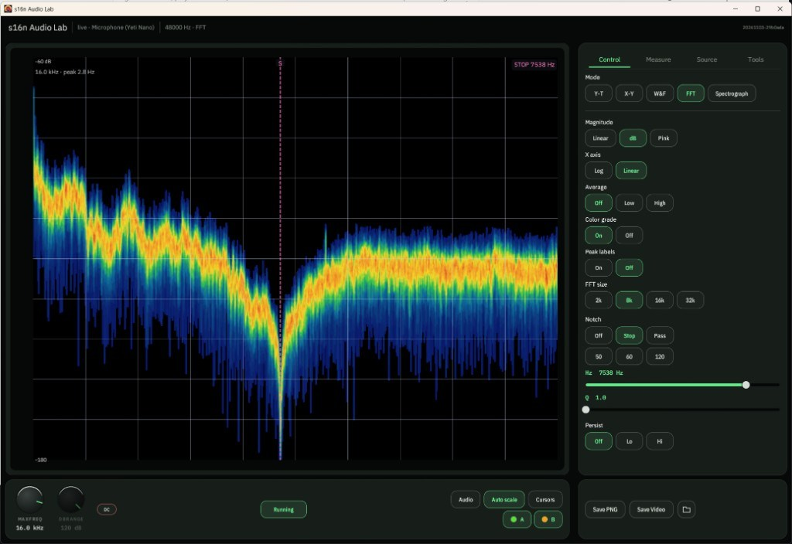
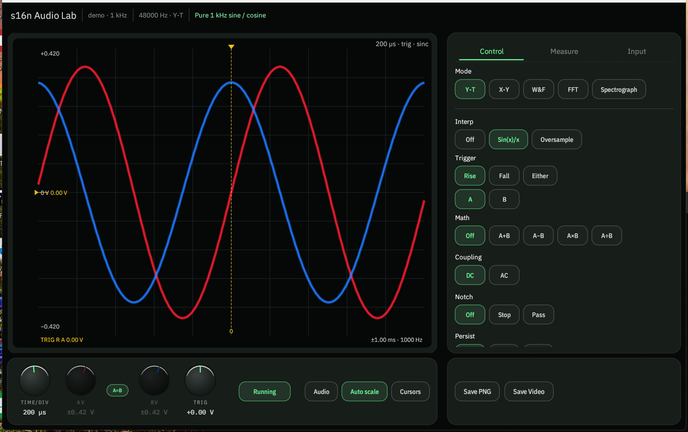
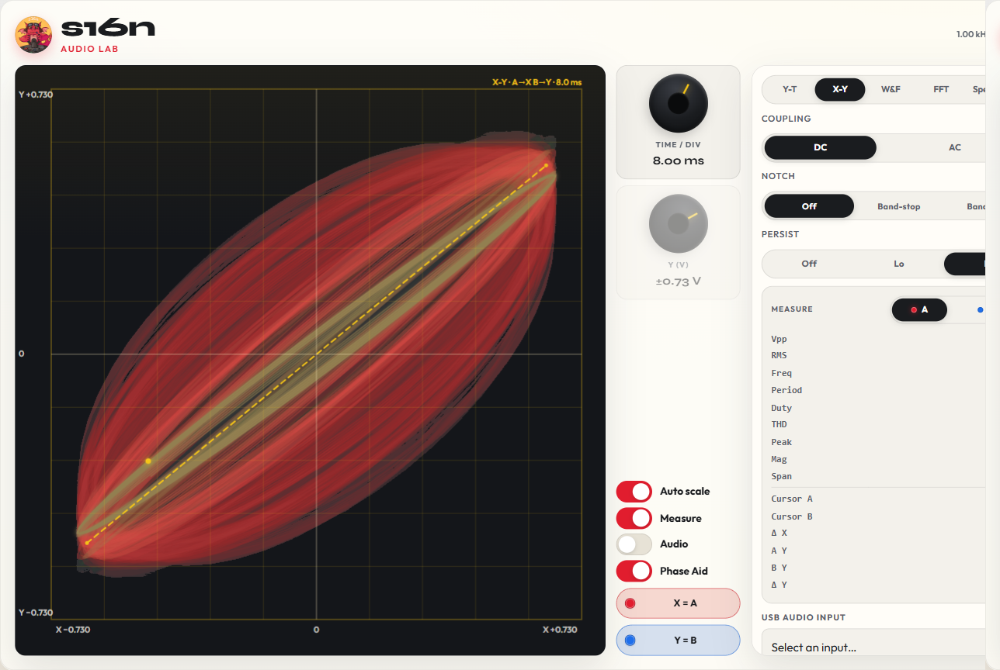
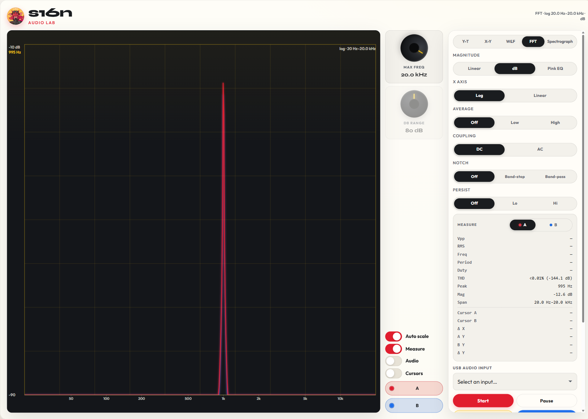
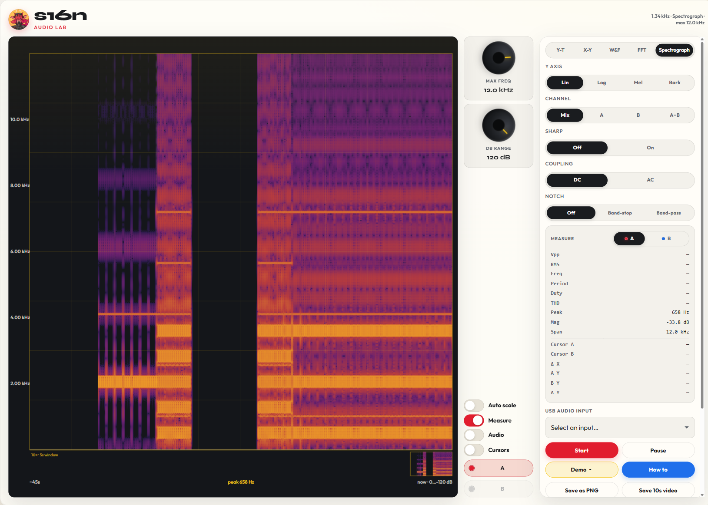
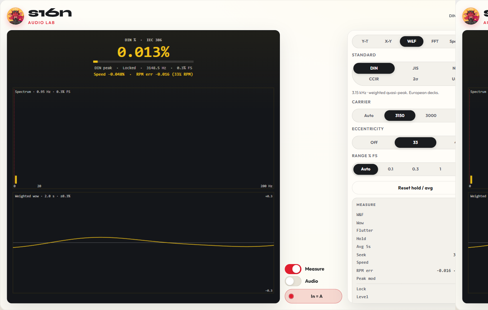
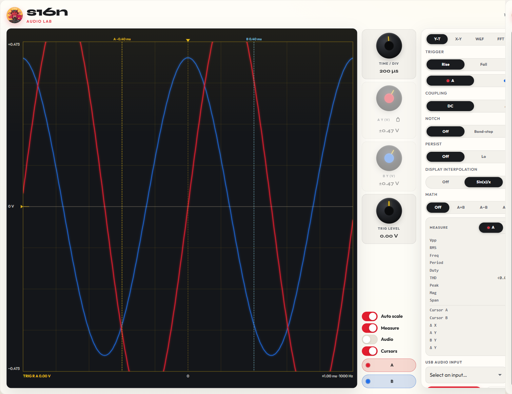

{: .center-image }

A desktop audio tool with advanced features — **Y-T**, **X-Y**, **FFT**, **Spectrograph**, and **W&amp;F**, plus triggers, cursors, measures, notch filtering, plot export, and a local **MCP server** so AI agents and scripts can drive the lab. Audio frequency only (not RF or lab-bandwidth scopes). Plug in a USB ADC, pick the device, and Run — or use the built-in examples. Useful for turntables and tape decks (azimuth, anti-skate, W&amp;F, frequency response), codecs, and other line-level gear.

Licensed desktop unlocks the full feature set. **$25 / year** via PayPal (enter the email you paid with and the license key in the app). Local app, local settings — no account. Windows, Linux, and macOS (Apple Silicon).

<div class="cta-row">
  <a class="btn btn--primary" href="https://github.com/stuart11n/s16n-releases/releases/download/audio-lab-latest/s16n-audio-lab.exe">Download for Windows</a>
  <a class="btn btn--ghost" href="#linux">Linux</a>
  <a class="btn btn--ghost" href="#macos">macOS ARM</a>
  <a class="btn btn--ghost" href="https://scope.s16n.com">Free Web Version</a>
  <a class="btn btn--info" href="{{ '/projects/audio-lab/how-to/' | relative_url }}">How To</a>
</div>

Default window ~1280×800 (minimum width 1280).

### Display modes

- **Y-T** — amplitude vs time, dual channel
- **X-Y** — Lissajous / vector plot (A vs B)
- **FFT** — spectrum
- **Spectrograph** — scrolling waterfall (time × frequency)
- **W&amp;F** — wow &amp; flutter meter and demod waveform

### Input &amp; monitoring

- **Source** tab: Live ↔ Example, device picker, **Max Input Level** (dBV at 0 dBFS, per device), **Channel B sample trim** (−10…+10)
- **Tools** tab: tone generator on the default playback device — Level, frequency presets, Start / Stop
- **Audio** speaker monitor (off by default)
- **AC** / **DC** coupling
- Notch / band-pass style filter: on/off, frequency, Q, invert (stop vs pass), with on-plot S/P marker
- Max frequency ceiling tracks the open device’s **Nyquist** when the sample rate changes
- Settings persist in the OS config directory

### Dual channel

- Independent **A** / **B** enable and colour pickers
- Linked or unlocked vertical scales (A=B lock)
- On X-Y: **X = A**, **Y = B**

### Export

- **Save PNG** of the scope plot (framebuffer crop — matches what’s on screen). Ctrl/Cmd+S
- **Save Video** → WebM (AV1), plot region, timed capture of the painted frame

### MCP server

Drive Audio Lab from Cursor, Claude Desktop, Claude Code, or any localhost HTTP client. Off by default — turn on **Tools → MCP → SERVER ON**.

- Localhost only (`127.0.0.1`, default port **18765**)
- Read live state and measures (including spectrograph peak labels)
- Change settings remotely (mode, triggers, scales, filters, and more)
- Start / stop / configure the Tools tone generator
- Capture the plot as **PNG**, **CSV**, or **WAV**
- Stdio MCP bridge ships with the app (`lab_get`, `lab_set`, `lab_measure`, `lab_tone`, `lab_capture`)

### Y-T

- Time/div
- **Trigger**: rising / falling / either; source A or B; level; visual markers
- **Math** on screen: Off · A+B · A−B · A×B · A÷B
- Interpolation (including a sinc-style path)
- **Persist** Off / Lo / Hi — CRT-style trails that keep glowing across time/div changes
- Auto scale or manual volts/div

{: .center-image }

### X-Y

- Dedicated XY time window
- Phosphor persist
- **Phase Aid** — major-axis guide + tint (in-phase vs out-of-phase cue)

{: .center-image }

### FFT

- Magnitudes: **Linear** · **dB** · **Pink** (+3 dB/oct so ideal pink reads flat)
- X-axis: **Linear** · **Log**
- Averaging: Off / Low / High
- **Color grade** — DPX-style density fill under the spectrum (live stroke off while on; Persist is separate)
- Peak labels on/off
- Analysis lengths shared with Spectrograph: **2k · 8k · 16k · 32k** (default **2k**)
- Max frequency and dB range knobs; auto scale for level
- Frequency zoom: scroll about the cursor, drag a marquee when cursors are off, double-click / Reset for full span
- Peak frequency readout

{: .center-image }

### Spectrograph

- Scrolling waterfall (~**25 columns/s**, independent of window width and sample rate)
- ~**4.5 s** of main history at that rate
- Y-axis: **Linear · Log · Mel · Bark**
- Channel: **Mix · Left · Right · Diff**
- **Sharp** — reassigned / sharpened frequency display
- Shared FFT size with spectrum mode
- Overview scrub strip under the plot (scrub history; pauses while scrubbing)
- Max freq / dB range / auto scale

{: .center-image }

### Wow &amp; flutter

- Standards: **DIN · JIS · NAB · CCIR · AES 2σ · Unweighted**
- Carriers: **Auto · 3150 · 3000 · 1000 Hz**
- Eccentricity: **Off · 33⅓ · 45 RPM**
- Range: Auto or fixed **0.1% · 0.3% · 1% · 3%**
- Live readout: weighted %, wow, flutter, peak hold, carrier lock, level; reset hold

{: .center-image }

### Measure &amp; cursors

Side panels: **Control · Measure · Source · Tools**.

- Measure channel: **A · B · Math** (Math only when Y-T math is on)
- Readouts: **Vpp, RMS, Freq, Period, Duty, THD, Peak, Mag, Span**, plus cursor cells **XA/XB/ΔX, YA/YB/ΔY** when cursors are on
- Cursors on Y-T, FFT, and Spectrograph — drag A/B (and Y pairs on Y-T); units follow the mode

{: .center-image }

### Built-in examples

Chirp · 1 kHz · Harmonics · 4% THD · Tape · Sweep · Lissajous · CD eye · Osci · Pink · Turntable · Hello · Aphex · Dial-up

How-tos for a reference tape or test record are in [How To]({{ '/projects/audio-lab/how-to/' | relative_url }}): input level, Tools tone generator, controls, recommended ADC and input sample trim, tape-head azimuth, tape and turntable W&amp;F, turntable frequency response, anti-skate, and cassette or turntable channel balance.

### Example: Lissajous

X-Y for tape-head azimuth — aim for a tight, stable ellipse/line on a high-frequency test tone. **Phase Aid** draws a chord line to help with alignment.

<video class="center-image" autoplay muted loop playsinline preload="auto" src="{{ '/assets/images/turntable-audio/scope-lissajous.webm' | relative_url }}">
</video>

### Example: FFT

<video class="center-image" autoplay muted loop playsinline preload="auto" src="{{ '/assets/images/turntable-audio/scope-fft.webm' | relative_url }}">
</video>

### Example: spectrograph

A face drawn in frequency bands while the waterfall scrolls right→left.

<video class="center-image" autoplay muted loop playsinline preload="auto" src="{{ '/assets/images/turntable-audio/scope-spectrograph.webm' | relative_url }}">
</video>

### Example: dial-up modem

Handshake then carrier — probe tones stack as bars, then the waterfall fills with the data burst.

<video class="center-image" autoplay muted loop playsinline preload="auto" src="{{ '/assets/images/turntable-audio/scope-dialup.webm' | relative_url }}">
</video>

### Linux

x86_64 binary. Requires **glibc 2.35+** (Ubuntu 22.04+, Debian 12+, Fedora 36+, and similar).

**Fedora** — `alsa-lib` `gtk3` `libxkbcommon` `libxcb` `mesa-libGL` `libX11`

```
sudo dnf install alsa-lib gtk3 libxkbcommon libxcb mesa-libGL libX11
```

**Debian / Ubuntu** — `libasound2` `libgtk-3-0` `libxkbcommon0` `libxcb-shape0` `libxcb-xfixes0` `libgl1` `libx11-6`

```
sudo apt install libasound2 libgtk-3-0 libxkbcommon0 libxcb-shape0 libxcb-xfixes0 libgl1 libx11-6
```

<div class="cta-row">
  <a class="btn btn--primary" href="https://github.com/stuart11n/s16n-releases/releases/download/audio-lab-latest/s16n-audio-lab-linux">Download for Linux</a>
</div>

### macOS

Apple Silicon (arm64) **.dmg**. The build is not notarized, so Gatekeeper will block the first launch.

1. Open the disk image and drag **s16n Audio Lab** to Applications (or run it from the mount).
2. When macOS says it “can’t be opened” / was blocked, open **System Settings → Privacy &amp; Security** (or **System Preferences → Security &amp; Privacy** on older macOS).
3. Scroll to the security messages at the bottom and click **Open Anyway** for Audio Lab. Confirm again if prompted.

You can also **Control-click** (or right-click) the app → **Open** the first time, then confirm.

<div class="cta-row">
  <a class="btn btn--primary" href="https://github.com/stuart11n/s16n-releases/releases/download/audio-lab-latest/s16n-audio-lab-macos-arm.dmg">Download for macOS ARM</a>
</div>
