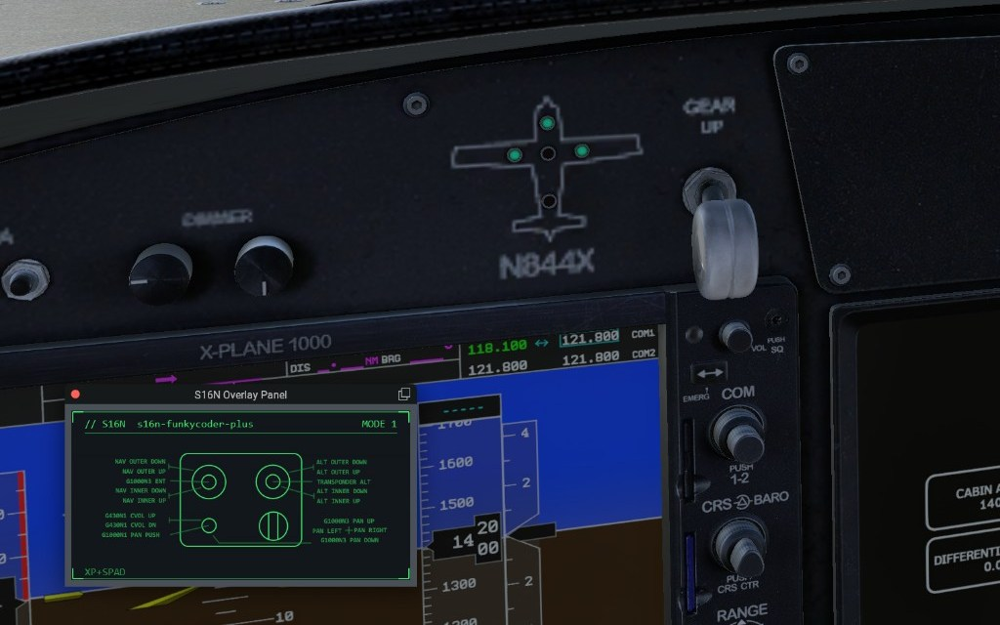
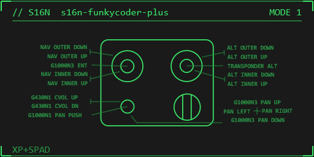
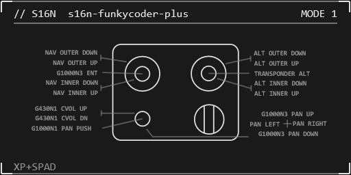
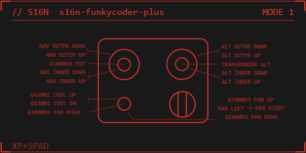
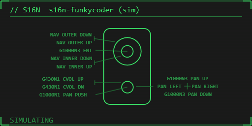
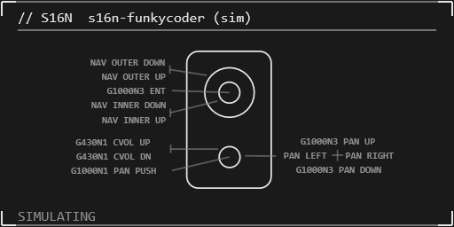
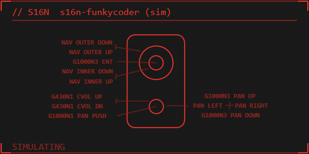

Windows app that draws a live overlay of your **Funky Coder** or **Funky Coder Plus**, with **automatic labels** from the active sim / SPAD.neXt binds. Float it in **X-Plane 12** or **MSFS 2024**, or push an experimental **OpenXR** HUD in VR.

{: .center-image }

  <a class="btn btn--primary" href="https://github.com/stuart11n/s16n-releases/releases/download/controller-panel-latest/s16n-controller-panel-setup.exe">Download for Windows</a>
  

### Controllers

- **Funky Coder** and **Funky Coder Plus**
- Device pictogram + pin map per unit — knobs, pushes, and hats drawn from the hardware layout
- Live button / encoder activity on the panel
- Mode chrome when the device has mode pins (**MODE 1**, **MODE 2**, …)
- Selection remembered across launches; hot plug refresh

### Automatic labels

Labels are pulled from the **active bind files** for the sim or middleware in focus — not hand-typed on the panel.

- Reads MSFS, X-Plane 12, and **SPAD.neXt** bind / profile data
- SPAD names win when SPAD is providing a label for that button
- Leader lines point from each control to its bound action (NAV outer/inner, ALT, G1000, transponder, pan, …)
- Host tag on the panel footer (e.g. **XP+SPAD**, **MSFS**, **SPAD**)
- HUD color: **green · white · red** (cycle in the app)

**Funky Coder Plus**

{: .center-image }

{: .center-image }

{: .center-image }

**Funky Coder**

{: .center-image }

{: .center-image }

{: .center-image }

### X-Plane 12

- Floating **S16N Overlay Panel** plugin window inside the sim
- Install from the app’s **Install** tab (or the bundled plugin payload)
- Menu: **Plugins → S16N Overlay → Show Overlay Panel**
- Same shared-memory image the desktop app and OpenXR path use

### MSFS 2024

- In-game toolbar panel (**S16N Overlay**) via the Community package
- Install / remove from the **Install** tab pointing at your Community folder
- Fully restart MSFS after install

### SPAD.neXt

- Watches SPAD bind / profile files for the selected s16n device
- Labels update when you reassign in SPAD
- Works alongside XP12 or MSFS (footer shows **XP+SPAD** / **MSFS+SPAD** when both are live)

### OpenXR HUD (experimental)

- Implicit OpenXR API layer composites the same panel as a transparent quad in the headset
- Optional system-wide (HKLM) registration from the installer or **Install** tab
- Nudge position / size, VIEW vs LOCAL space, visibility, alpha
- One-eye capture for debugging (F8)
- Tested against common Windows OpenXR runtimes (e.g. Pimax); treat as experimental

### Also in the app

- **Devices** — pick the Funky Coder / Plus, refresh HID list
- **Binds** — active bind files for MSFS / XP12 / SPAD.neXt
- **Install** — OpenXR layer, MSFS Community panel, X-Plane 12 plugin
- Optional start with Windows (system tray)
- Windows 10/11 x64 installer (`s16n-controller-panel-setup.exe`)

### Requirements

- Windows 10/11 x64
- An s16n **Funky Coder** or **Funky Coder Plus** revision 2 with PID **FFC1**, **FFC2**
- X-Plane 12 and/or MSFS 2024 for the in-sim panels; SPAD.neXt optional for bind labels
- An OpenXR runtime if you use the experimental VR HUD
