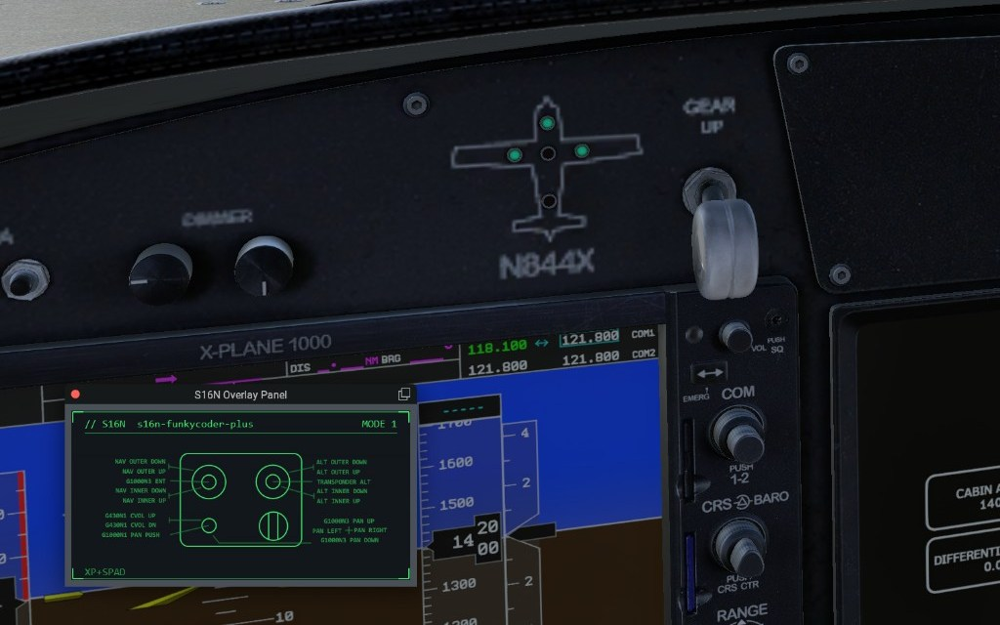
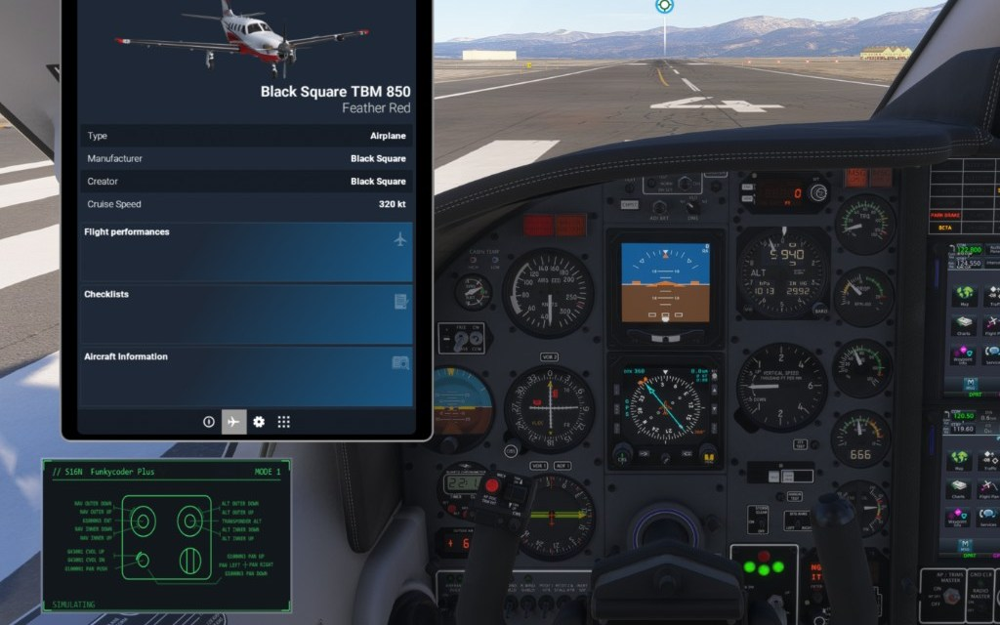
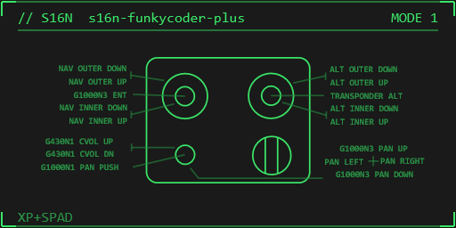
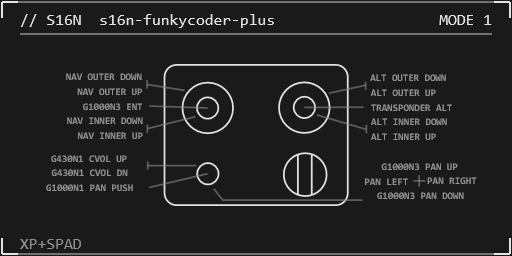
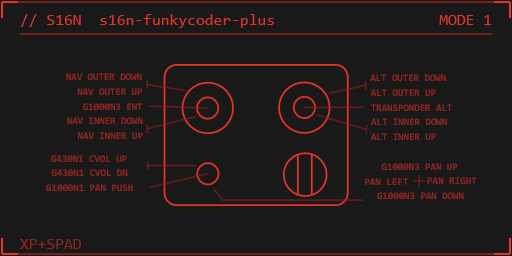
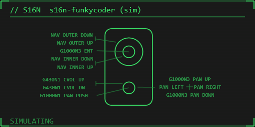
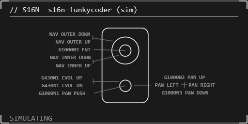
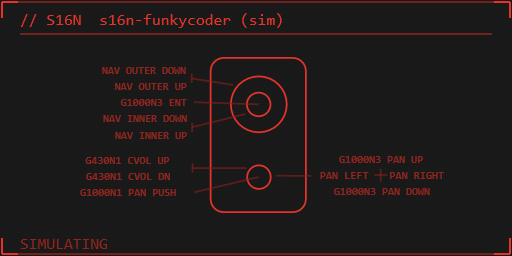

Windows app that draws a live **HUD** for your **Funky Coder** or **Funky Coder Plus**, with **automatic labels** from the active sim / SPAD.neXt binds. Float it in **X-Plane 12** or **MSFS 2024**, or push an experimental **OpenXR** HUD in VR.

{: .center-image }

{: .center-image }

<div class="cta-row">
  <a class="btn btn--primary" href="https://github.com/stuart11n/s16n-releases/releases/download/hud-latest/s16n-hud-setup.exe">Download for Windows</a>
  
</div>

### Controllers

- **Funky Coder** and **Funky Coder Plus**
- Device pictogram of the physical hardware layout
- Live button / encoder activity on the HUD reflecting the mode (if applicable)
- Mode chrome when the device has mode pins (**MODE 1**, **MODE 2**, …)
- Selection remembered across launches; hot plug refresh

### Automatic labels

Labels are pulled from the **active bind files** for the sim or middleware in focus — not hand configured.

- Reads MSFS, X-Plane 12, and **SPAD.neXt** bind / profile data
- In **SPAD.neXt**, use the **button label** to specify the overlay text; SPAD labels win when present
- Leader lines point from each control to its bound action (NAV outer/inner, ALT, G1000, transponder, pan, …)
- Host tag on the HUD footer (e.g. **XP+SPAD**, **MSFS**, **SPAD**)
- HUD color: **green · white · red** (cycle in the app)

**Funky Coder Plus**

{: .center-image }

{: .center-image }

{: .center-image }

**Funky Coder**

{: .center-image }

{: .center-image }

{: .center-image }

### X-Plane 12

- Floating **S16N HUD** plugin window inside the sim
- Install from the app’s **Install** tab (or the bundled plugin payload)
- Menu: **Plugins → S16N Overlay → Show Overlay Panel**
- Same shared-memory image the desktop app and OpenXR path use

### MSFS 2024

- In-game toolbar panel (**S16N HUD**) via the Community package
- Install / remove from the **Install** tab pointing at your Community folder
- Fully restart MSFS after install

### SPAD.neXt

- Watches SPAD bind / profile files for the selected s16n device
- Set each control’s **button label** in SPAD.neXt to the text you want on the HUD
- Labels update when you change binds or labels in SPAD
- Works alongside XP12 or MSFS (footer shows **XP+SPAD** / **MSFS+SPAD** when both are live)

### OpenXR (experimental)

- Implicit OpenXR API layer composites the same HUD as a transparent quad in the headset
- Optional system-wide (HKLM) registration from the installer or **Install** tab
- Nudge position / size, VIEW vs LOCAL space, visibility, alpha
- One-eye capture for debugging (F8)
- Tested against common Windows OpenXR runtimes (e.g. Pimax); treat as experimental

### Per-eye gamma / RGB in VR (experimental)

Balance a headset whose two panels don't quite match — one eye a little darker, warmer, or greener than the other. The OpenXR layer color-grades the **sim's VR world image** independently for each eye, before the runtime shows it. **DirectX 12 (MSFS 2024) only** — not supported on DirectX 11, including X-Plane 12.

- **Options** tab → **OpenXR per-eye world color (VR view)**: a **Left eye** and **Right eye** column, each with **Gamma**, **R**, **G**, **B** sliders
- **Gamma** 0.2–3.0 (default 1.0): above 1 lifts the midtones, below 1 darkens them; blacks and whites stay put
- **R / G / B** 0–2 (default 1.0): per-channel gain for that eye
- **Reset left** · **Reset right** · **Reset both** restore the active preset's factory values
- Changes apply live in the headset; settings are saved and restored on the next launch
- Also scriptable from the [Local HTTP API](#local-http-api) (`/overlay/gamma`, `/overlay/rgb`, `/overlay/color-preset`) — e.g. from SPAD.neXt

**Presets** — **Slots (both eyes)** holds three independent grades; press **P** in the app to cycle them:

- **Preset 1** — neutral
- **Preset 2** — dark sunglasses (approximates OpenXR Toolkit *Dark*)
- **Preset 3** — night (approximates OpenXR Toolkit *TruNite*)

Each preset keeps its own left / right values. The sliders, Reset and the HTTP gamma / RGB calls edit only the active preset, and switching never overwrites the others — so you can tune, say, a day and a night look and flip between them.

Good to know:

- **DirectX 12 only (MSFS 2024).** Grading is not supported on DirectX 11 — that includes **X-Plane 12**. The sliders and presets have no effect there; the HUD itself still works
- Only the world is graded — the HUD and the 2D in-sim panels are unchanged
- An eye left at default costs nothing. Where the sim's eye images allow it, each adjusted eye is graded in place with a single GPU compute pass; otherwise the layer falls back to a separate copy, which costs a little more
- Fully restart MSFS after installing or updating the layer
- **Frame generation:** if you use an OpenXR frame-generation layer, the s16n layer (`XR_APILAYER_S16N_HUD`) must sit **before** it (closer to the sim), so the frames it generates are built from the graded image. Check or change the order with a layer manager such as [OpenXR API Layers GUI](https://github.com/fredemmott/OpenXR-API-Layers-GUI)

### Also in the app

- **Devices** — pick the Funky Coder / Plus, refresh HID list
- **Binds** — active bind files for MSFS / XP12 / SPAD.neXt
- **Install** — OpenXR layer, MSFS Community panel, X-Plane 12 plugin
- Status bar shows the active bind sources and the app version
- Optional start with Windows (system tray)
- Windows 10/11 x64 installer (`s16n-hud-setup.exe`)

### Local HTTP API

While the app is running it listens on **`http://127.0.0.1:18765`** (localhost only). CORS allows GET / POST / OPTIONS. Query values are URL-decoded; surrounding quotes are stripped. Control calls that succeed return JSON including color, visibility, position, and size.

Can be driven from **SPAD.neXt** (or any localhost HTTP client) — more reliable than sending keystrokes into the app.

#### Status

| Method | Path | Purpose |
|--------|------|---------|
| GET | `/status` or `/status.json` | Liveness snapshot: `pixelSeq`, `visible`, `width`, `height`, `port` |
| GET | `/status/1` · `/status/2` · `/status/3` | Set footer status ring. Query: `value=0` or `value=1` |
| GET | `/status/text` | Set footer text (max 64 chars). Query: `value=...` |

Examples:

```
GET http://127.0.0.1:18765/status.json
GET http://127.0.0.1:18765/status/1?value=1
GET http://127.0.0.1:18765/status/text?value=GEAR%20DOWN
```

#### HUD controls

| Method | Path | Query `value` | Purpose |
|--------|------|---------------|---------|
| GET | `/color` | `next` (or empty), `green`, `white`, `red` | Cycle or set HUD tint |
| GET | `/overlay/size` | `up`, `down` | Scale the OpenXR quad (~1.1× / ÷1.1) |
| GET | `/overlay/nudge` | `left`, `right`, `up`, `down`, `near`, `far` | Nudge OpenXR pose (~2 cm) |
| GET | `/overlay/visible` | `0`, `1`, `toggle` (or empty) | Hide / show / toggle the overlay |
| GET | `/overlay/gamma` | `eye=left\|right\|both`, `value=<float>` | Per-eye VR world gamma (0.2–3.0; default 1.0) |
| GET | `/overlay/rgb` | `eye=left\|right\|both`, optional `r` / `g` / `b` floats | Per-eye VR world RGB gains (0–2; default 1.0; omit a channel to leave it unchanged) |
| GET | `/overlay/color-preset` | `preset1`, `preset2`, `preset3` (or empty to read) | Select the active eye-color preset |

Successful control calls return JSON including tint, visibility, pose/size, plus `eyeColorPreset` and per-eye `gamma` and `rgb`. Gamma / RGB edit the active preset, like the Options sliders, and only take effect in DirectX 12 sims (MSFS 2024) — see [Per-eye gamma / RGB in VR](#per-eye-gamma--rgb-in-vr-experimental).

Examples:

```
GET http://127.0.0.1:18765/color?value=green
GET http://127.0.0.1:18765/overlay/nudge?value=up
GET http://127.0.0.1:18765/overlay/visible?value=toggle
GET http://127.0.0.1:18765/overlay/gamma?eye=left&value=1.2
GET http://127.0.0.1:18765/overlay/rgb?eye=right&r=1.05&b=0.95
GET http://127.0.0.1:18765/overlay/color-preset?value=preset3
```

#### Panel geometry (MSFS)

| Method | Path | Purpose |
|--------|------|---------|
| GET | `/panel_geom` or `/panel_geom.json` | Read saved in-sim panel rect; `{}` if none |
| GET | `/panel_geom.json?left=&top=&width=&height=` | Save panel rect (preferred) |
| POST | `/panel_geom.json` | Save panel rect from a JSON body `{"left":…,"top":…,"width":…,"height":…}` |

#### Diagnostics

| Method | Path | Purpose |
|--------|------|---------|
| GET | `/log?...` | Append a diagnostic line to the app log (204) |
| OPTIONS | any | CORS preflight (204) |

### Requirements

- Windows 10/11 x64
- An s16n **Funky Coder** or **Funky Coder Plus** revision 2 with PID **FFC1**, **FFC2**
- X-Plane 12 and/or MSFS 2024 for the in-sim panels; SPAD.neXt optional for bind labels
- An OpenXR runtime if you use the experimental VR HUD
