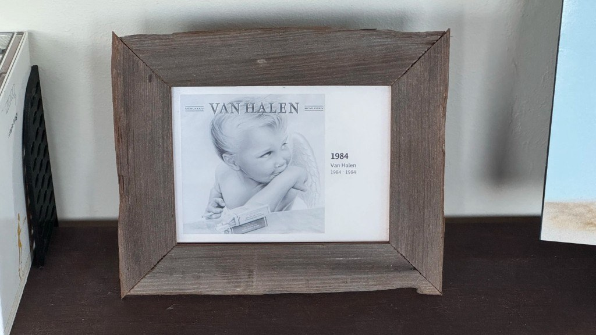
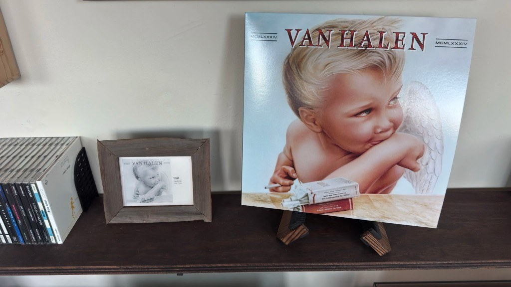
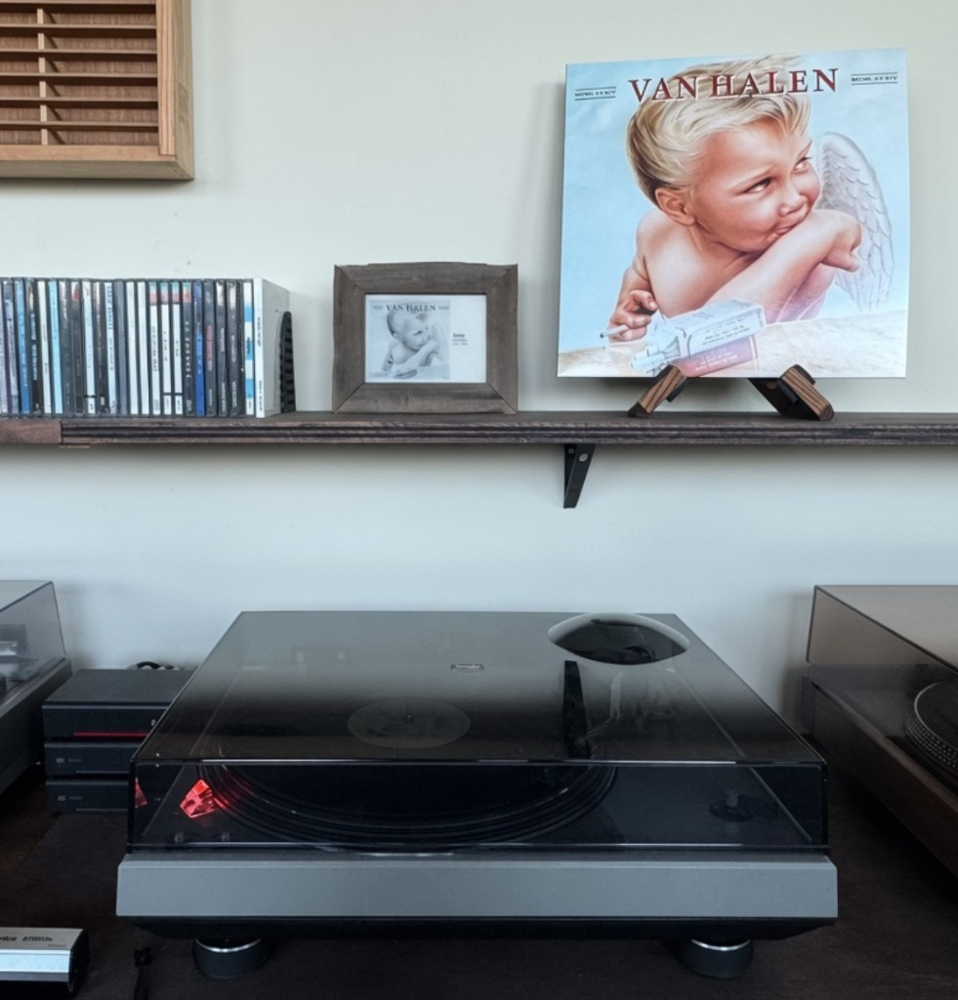
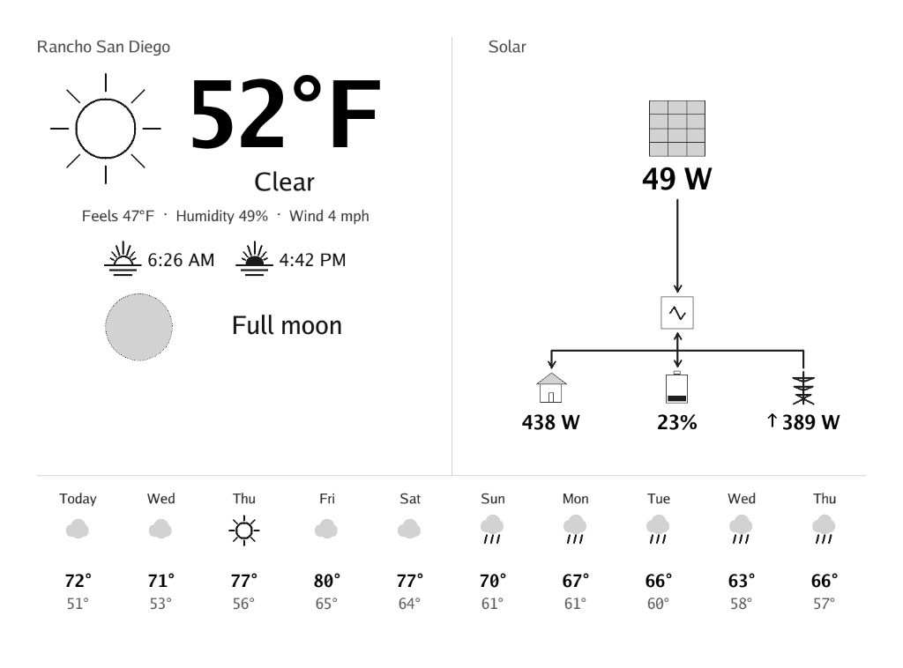
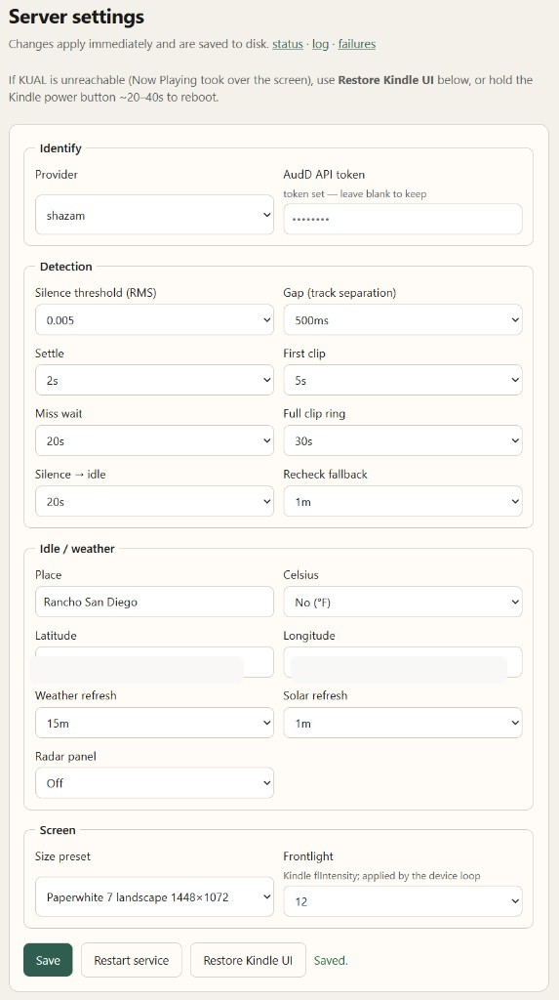
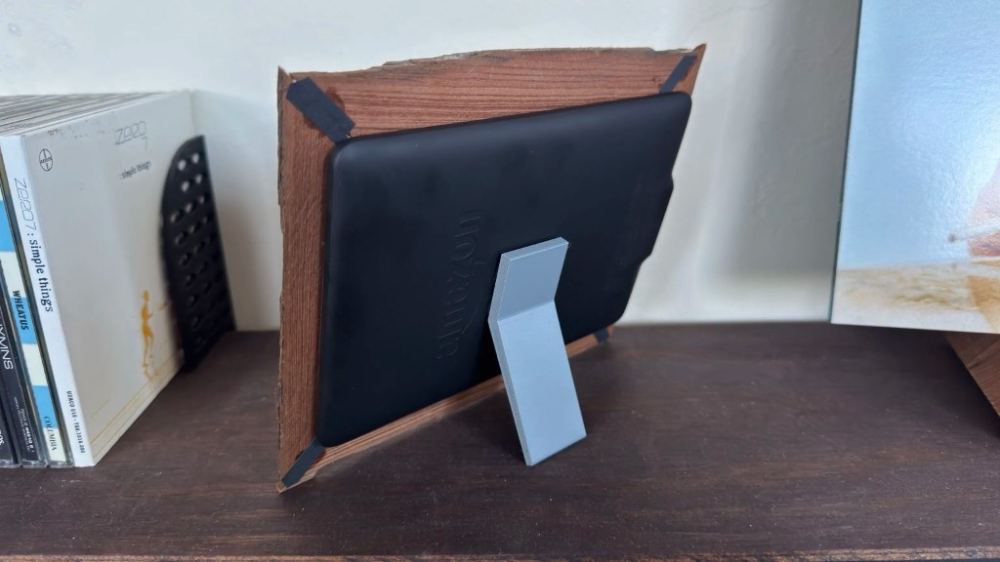

{: .center-image }

**KindleID** turns a jailbroken Kindle into a always-on **now playing** display. Drop a record, start a playlist, or put something on the turntable — a Raspberry Pi on the LAN hears it, figures out what it is, and the Kindle redraws with cover art, title, artist, and year.

The Kindle never listens. It’s just a Wi‑Fi picture frame that polls a tiny Go server and paints grayscale PNGs with FBInk.

  <a class="btn btn--primary" href="https://github.com/stuart11n/kindleID" target="_blank" rel="noopener noreferrer">View on GitHub</a>

{: .center-image }

{: .center-image }

### How it works

1. **Listen** — A USB mic on a Raspberry Pi captures room audio (ALSA `arecord` on the Pi; WASAPI works for Windows development). The stream is mono’d and brought to 16&nbsp;kHz for fingerprinting.
2. **Decide when to ask** — A small state machine watches level: sound settles → send a short clip; silence for a bit → idle screen; while something is playing, re-check about once a minute.
3. **Identify** — The clip goes to **Shazam** (via [`goshazam`](https://github.com/alexgorbatchev/goshazam)), **AudD**, or both in parallel (first match wins). You get title, artist, album, year, and a cover URL.
4. **Render** — The Pi builds a grayscale PNG sized for the Paperwhite (cover + type; soft-rotated if the Kindle sits on its side).
5. **Show** — A KUAL extension on the Kindle polls `http://<pi>:8080/version`. When the hash changes it downloads `/screen.png` and updates the panel with **FBInk**. Frontlight and screensaver are driven over `lipc`.

When nothing is playing for a while, the same pipeline draws an **idle** screen (Open-Meteo weather, optional radar, optional SolarEdge Modbus stats) instead of a frozen last track:

{: .center-image }

### Hardware

- A **jailbroken Kindle** with **KUAL** and **FBInk** (Paperwhite 5 / 6 / 7 sizes in settings; intended side-mounted, USB on the left)
- A **Raspberry Pi** on the same LAN (tested on an original 2011 Pi 1 Model B / ARMv6 with Raspberry Pi OS Legacy Lite armhf)
- A **USB microphone** (or other ALSA capture device)
- Optional: SolarEdge inverter on Modbus TCP for the idle screen

### Software

- Go service on the Pi (`kindle-shazam`): listen → detect → identify → render → HTTP on port **8080**
- Kindle KUAL extension **Now Playing**: Start stops the stock UI and runs the poll loop; a browser **Restore Kindle UI** path on `/settings` can bring the normal Kindle UI back if you can’t reach KUAL
- Identify modes: `shazam`, `audd`, or `both` (AudD API token required for AudD / both)
- Web **`/settings`**: thresholds, provider, location, screen size, frontlight

{: .center-image }

Deploy from a filled-in `config.local.json` with `deploy/pi/deploy.ps1` (cross-builds `GOARM=6`, installs systemd + env, optionally syncs the extension when the Kindle is USB-mounted).

{: .center-image }
